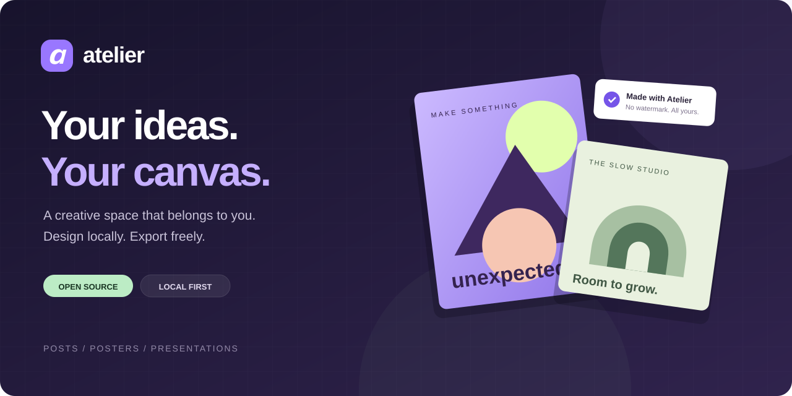
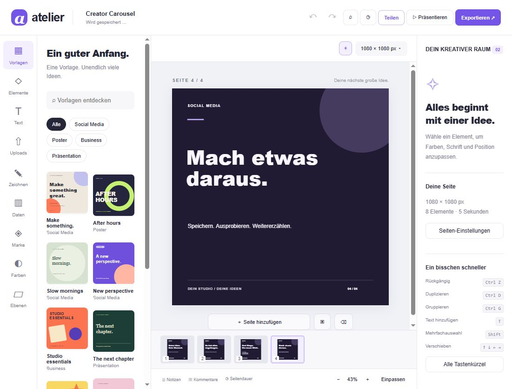
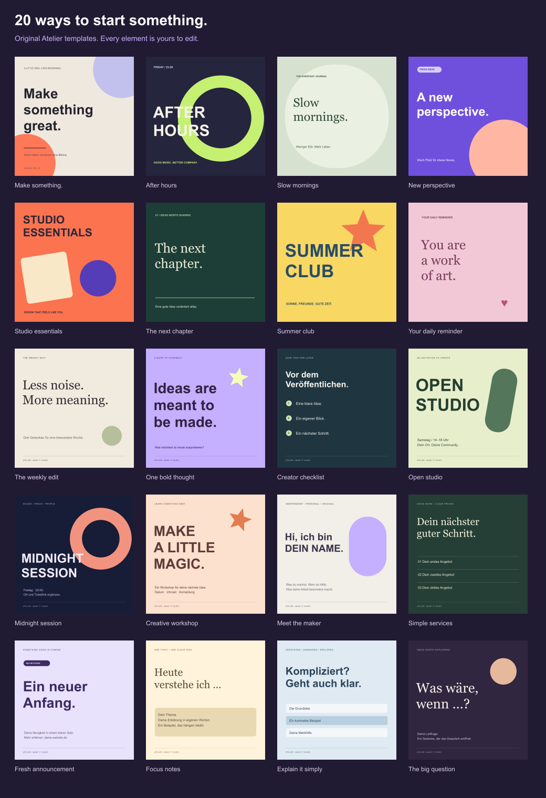
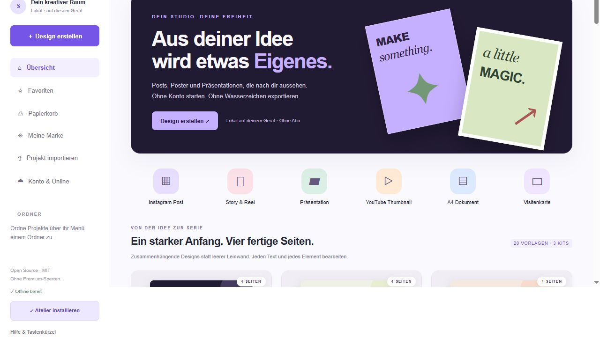

<p align="center"></p>

<p align="center">
<a href="https://github.com/m4z8p6fy9m-coder/atelier-design-studio/actions/workflows/pages.yml"></a>
<a href="LICENSE"></a>


</p>

<p align="center"><a href="https://github.com/m4z8p6fy9m-coder/atelier-design-studio/releases/tag/v0.9.0"><strong>↓ Download Atelier 0.9</strong></a> · <a href="docs/START-HERE.md">Start in two minutes</a></p>

<h1 align="center">A creative space that belongs to you.</h1>
<p align="center">Create social posts, posters and presentations in your browser.<br>Start without an account. Keep your designs locally. Export without watermarks.</p>
<p align="center"><a href="#get-started"><strong>Get started</strong></a> · <a href="#inside-the-studio">Explore features</a> · <a href="docs/REFERENCE.de.md">Deutsche Anleitung</a> · <a href="CONTRIBUTING.md">Contribute</a></p>

<p align="center"><br><sub>Atelier 0.8 · Four-page Creator Carousel, fully editable.</sub></p>

## Why Atelier?

Your first design should start with an idea. Atelier gives you an independent editor with a local workflow, editable templates and familiar design tools. The static editor needs no signup, API key or subscription. Implemented features have no premium gates or export watermarks.

This is an early-stage, independent project under the MIT license. It is **not a complete Canva replacement** and is not affiliated with Canva or Adobe. The application code and bundled templates were created for this project. See the [feature inventory](docs/FEATURES.md) and [scope comparison](docs/AUDIT-CANVA.md) for current limitations.

## New in 0.9

**20 editable templates. An installable studio. An offline application shell.** Create with twelve new layouts for social posts, events, business and learning. Install Atelier from a supported browser after its first complete online load. Account features still require a connection. [Installation and offline details](docs/OFFLINE.md).



### Four-page starter kits

Three editable, four-page starter kits: **Creator Carousel**, **Product Story** and **Study Notes**. Open a kit from the redesigned studio homepage, make it yours, then export your pages. No account or API key required.



## Get started

**Download:** get `Atelier-v0.9.0.zip` from [Releases](https://github.com/m4z8p6fy9m-coder/atelier-design-studio/releases/tag/v0.9.0), extract it and follow [START-HERE.md](docs/START-HERE.md). This is a portable source package, not a standalone installer; **Node.js 20.12+ is required**.

Or clone the repository and run from its root:

```sh
git clone https://github.com/m4z8p6fy9m-coder/atelier-design-studio.git
cd atelier-design-studio
npm start
```

Open **http://127.0.0.1:4173**. On Windows, you can also double-click `START-WINDOWS.cmd`. Keep the server running. The static editor starts without installing npm dependencies.

**Try a ready-made design:** in the project overview, choose **Projekt importieren** and select [creator-studio.atelier.json](examples/creator-studio.atelier.json). It includes three pages and a chart.

The current application interface and detailed guides are in German. Desktop browsers are the main target.

## Inside the studio

| Create | Refine | Share |
| :--- | :--- | :--- |
| Starter templates and your own template library | Alignment, snapping, groups and layers | PNG, JPG and SVG |
| Text, curved text and your own font files | Gradients, shadows and transparency | Multiple pages as a ZIP |
| Shapes, drawing and image uploads | Image filters, crop and masks | PDF through browser print |
| Charts and tables with CSV data | Color-based background removal and manual brushes | WebM page animations without audio |
| Multipage posts, posters and presentations | Command search with Ctrl/Cmd+K | Standalone HTML and PowerPoint image slides |

Local autosave, project import/export, manual versions, folders, favorites and a recoverable trash help organize your work. Export important projects as Atelier files for backups.

**Optional accounts and shared projects:** the included Node server adds email verification codes, password recovery, Google sign-in, project roles and invitations. Email delivery and Google sign-in require your own provider configuration. Hosting and providers may have costs. Start with the [server guide](docs/SERVER.md) and [account guide](docs/ACCOUNTS.md).

## Know the boundaries

- Local projects belong to this browser and website address. Clearing browser data removes them; export backups first.
- Background removal uses color selection and manual editing, not AI segmentation.
- PowerPoint exports contain rendered image slides, not editable PowerPoint objects. PPTX import is not supported.
- WebM exports animate design pages; a full video editor, audio tracks and generative AI are not included.
- Shared projects use version checks and conflict copies; simultaneous edits do not use CRDT/OT merging.

See [all features and remaining gaps](docs/FEATURES.md) and the [detailed reference](docs/REFERENCE.de.md) before relying on a specific workflow.

## Find your way around

```text
atelier-design-studio/
├── src/              Browser editor, rendering, storage and exports
├── server/           Optional accounts, email and shared projects
├── scripts/          Local servers, configuration checks and build
├── tests/            Node tests and browser verification
├── docs/             Guides, screenshots and brand artwork
├── examples/         Editable designs and sample PowerPoint export
└── .github/          CI workflow, issue forms and PR template
```

| I want to… | Start here |
| :--- | :--- |
| Use the editor and understand exports | [German reference](docs/REFERENCE.de.md) |
| Learn the latest tools | [Commands, snapping and images](docs/EDITOR-TOOLS.md) |
| Set up accounts or real email delivery | [Accounts](docs/ACCOUNTS.md) · [Gmail](docs/GMAIL.md) · [WEB.DE](docs/WEBDE.md) |
| Run a shared project server | [Server guide](docs/SERVER.md) |
| See what was tested | [Validation](docs/VALIDATION.md) |
| Read release changes | [Changelog](CHANGELOG.md) |
| Help improve Atelier | [Contributing](CONTRIBUTING.md) · [Issues](https://github.com/m4z8p6fy9m-coder/atelier-design-studio/issues) |

## Develop and build

```sh
npm ci --ignore-scripts
npm run check
npm test
npm run build
```

The static output is written to `dist/`. After `npm start`, open **http://127.0.0.1:4173/tests/browser.html** for rendering, storage and export checks. The frontend uses browser APIs and native JavaScript modules; the optional server uses Nodemailer.

GitHub Actions checks, tests and builds on pushes to `main`. Pages deployment requires an explicit manual workflow run and available Pages hosting in your account. Pages serves the static editor; the optional account server needs a separate Node host. See the [deployment instructions](docs/REFERENCE.de.md#direkt-auf-github-hochladen).

Never commit `.env`, provider credentials or server `data/`. Read the [security policy](SECURITY.md) before reporting vulnerabilities.

## Make something worth sharing

Create a design, export it, and show what you made. When posting publicly, you can link back to Atelier so others can try the workflow. Reproducible bug reports, accessible UI improvements, documentation and focused feature contributions are welcome — see [how to contribute](CONTRIBUTING.md).

<p align="center"><br><sub>Independent tools. Room for your ideas.<br>MIT licensed · Built with native web APIs</sub></p>
