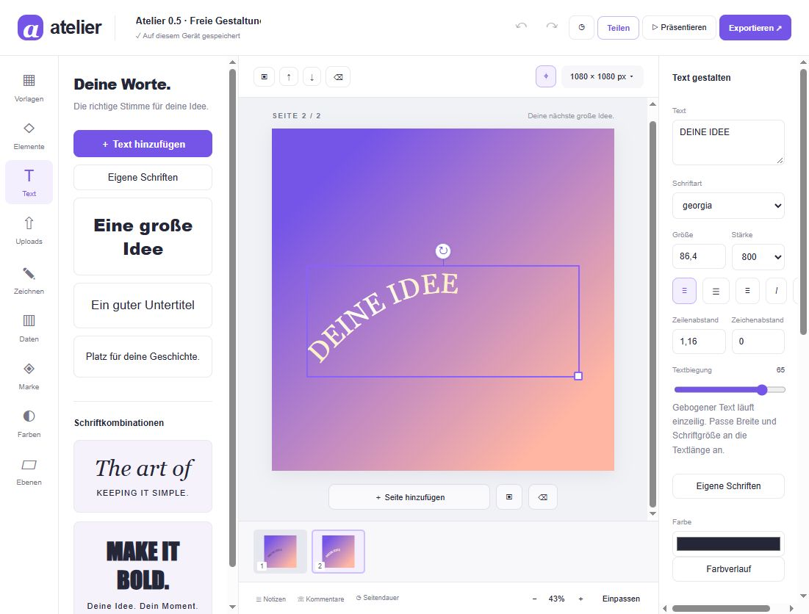

# Atelier Design Studio 0.7

Ein eigenständiger, lokal arbeitender Design-Editor für Social-Media-Posts, Poster und Präsentationen. Der Anwendungscode und die Vorlagen wurden für dieses Projekt erstellt. Es wurde kein Canva- oder ArtCraft-Quellcode übernommen. Atelier ist kein vollständiger Canva-Nachbau und steht in keiner Verbindung zu Canva.

**Neu in 0.3:** optionaler Node-Server mit Benutzerkonten, Online-Projekten, Freigaben mit Lese-/Bearbeitungsrechten, Live-Benachrichtigungen und Konfliktprüfung. Der statische Editor funktioniert weiterhin ohne Konto. [Server einrichten](SERVER.md).

**Neu in 0.4:** lokale Hintergrund-Farbauswahl mit Radier-/Wiederherstellungspinsel, Bild-Invertierung, sichere Elementlinks, eigenständiger HTML-Website-Export und PowerPoint-Bildfolienexport. Alle implementierten Werkzeuge sind ohne Abo, Premium-Sperre, API-Schlüssel oder Wasserzeichen-Abfrage nutzbar. Eigener Serverbetrieb kann Infrastrukturkosten verursachen.

**Neu in 0.5:** eigene eingebettete Schriftdateien, gebogener Text, lineare und radiale Farbverläufe für Seiten und Elemente sowie eine lokale Bibliothek eigener Vorlagen. [Bedienung und Grenzen](DESIGN-TOOLS.md).

**Neu in 0.7:** Befehlssuche mit Strg/Cmd+K, Einrasten an Seiten- und Elementkanten, Bilder austauschen bei gleichbleibendem Layout und Bilder als Hintergrund anordnen. [Neue Editor-Werkzeuge](EDITOR-TOOLS.md).

**Neu in 0.6.2:** WEB.DE-Versand mit eigenem App-Passwort und erzwungenem STARTTLS. Ein Google-Konto mit WEB.DE-Adresse benötigt für den Mailversand weiterhin WEB.DE-Zugangsdaten. [WEB.DE einrichten](WEBDE.md).

**Neu in 0.6.1:** echte Code-Mails über dein bestehendes Gmail-Konto, ohne eigene Domain. [Gmail einrichten](GMAIL.md).

**Neu in 0.6:** Registrierung mit E-Mail-Code, Passwort-Zurücksetzen, Google-Anmeldung und Kontoeinstellungen. Der Serveradapter versendet automatisch über Resend. Echte Mails und Google-Logins erfordern eigene Anbieter-Zugangsdaten und eine passende Website-Adresse. [Konten einrichten](ACCOUNTS.md).

**Prüfergebnis zum Original:** Es sind nicht alle Canva-Funktionen vorhanden. Der [detaillierte Abgleich mit öffentlichen Canva-Beschreibungen](AUDIT-CANVA.md) benennt die fehlenden Bereiche und unterscheidet Teilfunktionen von tatsächlicher Gleichheit.



## In zwei Schritten starten

Voraussetzung: **Node.js 20.12 oder neuer**. Für den lokalen Editor sind keine npm-Pakete oder API-Schlüssel erforderlich. Echte Konto-Mails und Google-Anmeldung benötigen die eigene Anbieter-Konfiguration.

```sh
npm start
```

Danach **http://127.0.0.1:4173/** öffnen. Unter Windows alternativ `START-WINDOWS.cmd` doppelklicken. Das Serverfenster geöffnet lassen. `index.html` wegen der JavaScript-Module nicht direkt als Datei öffnen.

Für den Modus mit Konten und gemeinsamen Projekten stattdessen zuerst **`npm ci --ignore-scripts`**, dann **`npm run cloud`** ausführen und **http://127.0.0.1:4174/** öffnen. Windows: `START-SERVER-WINDOWS.cmd`. Zuerst `.env.example` nach `.env` kopieren und die gewünschten Anmeldemethoden gemäß [ACCOUNTS.md](ACCOUNTS.md) konfigurieren. `npm run auth:check` prüft die lokale Einrichtung. Standardmäßig werden E-Mail-Konten erst nach Bestätigung aktiviert; ohne Maildienst ist diese Registrierung gesperrt.

Zum Ausprobieren enthält `examples/creator-studio.atelier.json` ein Design mit drei Seiten und einem Diagramm. In der Projektübersicht über „Projekt importieren“ öffnen.

## Funktionen

| Bereich | Enthalten |
| --- | --- |
| Projekte | Übersicht, Suche, Favoriten, Ordner, Umbenennen, Duplizieren, Papierkorb und Wiederherstellen |
| Editor | Drag-and-drop, Mehrfachauswahl, Gruppierung, Kopieren/Einfügen, Skalieren, Drehen, Spiegeln, Ausrichten, Verteilen, Einrasten an Seiten-/Elementkanten und Mittelpunkten |
| Texte | Sieben Systemschriften, eigene TTF/OTF/WOFF/WOFF2-Dateien, Textbiegung, Größe, Stärke, Kursiv, Unterstreichen, Zeilen- und Zeichenabstand, automatischer Wortumbruch |
| Gestaltung | 20 Startvorlagen, eigene Vorlagenbibliothek mit Archiv, Farbverläufe, Formen, Symbole, Farben, Konturen, Schatten, Transparenz, Ebenen sperren/ausblenden |
| Bilder | Austausch bei gleichem Rahmen, als Hintergrund anordnen, eigene PNG/JPG/WebP/GIF-Dateien, Bildausschnitt und Zoom, Rechteck-/Ellipsenmaske, Helligkeit, Kontrast, Sättigung, Unschärfe, Schwarzweiß |
| Freistellen | Hintergrundfarbe zusammenhängend entfernen, manuell radieren/wiederherstellen, acht Bearbeitungsschritte rückgängig; keine KI-Segmentierung |
| Zeichnen | Freihandlinien als bearbeitbare Vektorelemente, Farbe und Strichstärke |
| Daten | Balken-, Linien- und Ringdiagramme sowie Tabellen, editierbare CSV-Daten |
| Marke | Lokales Markenprofil mit Farben und Schrift, auf eine Seite anwendbar |
| Seiten | Mehrere Seiten, Duplizieren, Löschen, Reihenfolge, Formate und eigene Abmessungen |
| Präsentation | Vollbild, manuelle/automatische Navigation, Dauer, vier Übergangsoptionen, Sprechernotizen |
| Sicherung | IndexedDB-Autosave, Atelier-Projektdateien importieren/exportieren, zwölf manuelle Versionen je Projekt |
| Anmerkungen | Seitenkommentare mit Erledigt-Status; im Online-Projekt mitsynchronisiert |
| Konten, optional | Registrierung mit E-Mail-Code, Passwort-Wiederherstellung, Google-Anmeldung, Kontoeinstellungen, geschützte Sitzungen und Abmeldung auf allen Geräten |
| Gemeinsame Projekte, optional | Server-Speicherung, automatische Synchronisierung, Dokumentversionen und Konfliktkopien |
| Freigaben, optional | Eigentümer-, Bearbeiter- und Leserechte, zeitlich begrenzte Einladungen, Widerruf und Mitgliederverwaltung |
| Export | PNG/JPG in 1×/2×, transparentes PNG/SVG, mehrseitiger Bildexport als ZIP, SVG, PDF über Browserdruck, WebM-Seitenvideo |
| Website / PowerPoint | Selbstständige HTML-Datei mit Designseiten und Links; `.pptx` mit einem gerenderten Bild je Folie |

Desktop ist der Schwerpunkt. Auf schmalen Bildschirmen öffnet das Zahnrad die Eigenschaften; das Projektmenü enthält Notizen und Versionen. In der Übersicht führt das Navigationsmenü zu Favoriten, Ordnern und Papierkorb.

## Direkt auf GitHub hochladen

1. Ein leeres GitHub-Repository erstellen.
2. Den **Inhalt dieses Ordners** hochladen, einschließlich `.github/workflows/pages.yml` und `.gitignore`. Die `.github`-Datei muss im Repository unter genau diesem Pfad liegen. Beim Upload über die Website kann sie bei Bedarf dort separat angelegt werden.
3. Als Hauptbranch `main` verwenden. Unter **Settings → Pages → Build and deployment → Source** **GitHub Actions** wählen.
4. Für die Website-Veröffentlichung ausdrücklich **Actions → Test and deploy Atelier → Run workflow** starten. Die Ausgabe enthält bei erfolgreicher Veröffentlichung die Pages-Adresse.

Bei einem Push prüft der Workflow den Code, führt die Node-Tests aus und baut `dist/`. Eine Veröffentlichung über GitHub Pages erfolgt ausschließlich beim manuellen Workflow-Start. Der erste Prüflauf in diesem Repository wurde am 18. Oktober 2026 erfolgreich abgeschlossen. GitHub Pages und Repository müssen in deinem Konto verfügbar bzw. aktiviert sein.

**GitHub Pages veröffentlicht den statischen Modus.** Der Konten-/Teamserver benötigt separat einen Node-Host mit persistentem Speicher und HTTPS. Quellcode und Dockerfile dafür sind enthalten. Den Server-Datenordner `data/` und `.env` niemals manuell mit auf GitHub hochladen.

Offizielle Anleitung: [GitHub Pages mit eigenen Workflows](https://docs.github.com/en/pages/getting-started-with-github-pages/using-custom-workflows-with-github-pages).

Alternativ per Git, nachdem du deine Repository-URL eingesetzt hast:

```sh
git init
git add .
git commit -m "Initial Atelier design studio"
git branch -M main
git remote add origin DEINE-REPOSITORY-URL
git push -u origin main
```

## Prüfen und bauen

```sh
npm ci --ignore-scripts
npm run check
npm test
npm run build
```

`dist/` ist die fertige statische Website. Alle Dateipfade sind relativ, deshalb funktioniert sie auch unter einem GitHub-Pages-Unterpfad. Der Browser-Build hat keine Runtime-Abhängigkeiten. Für den Node-Server und die Servertests wird Nodemailer mit `npm ci --ignore-scripts` installiert.

Die Browserprüfungen lassen sich nach `npm start` unter **http://127.0.0.1:4173/tests/browser.html** starten. Sie testen echtes SVG-/Canvas-Rendering, PNG-Pixel und Transparenz, Bildfilter, Bildmasken, kombinierte Exporte, IndexedDB, ZIP und WebM-Dekodierung. Ein eigenes Testprojekt wird angelegt und danach wieder entfernt; vorhandene Projekte bleiben erhalten. Die Testseite wird nicht in `dist/` veröffentlicht.

## Speicher und praktische Grenzen

- Im statischen Modus liegen Projekte, Bilder und Markenprofile ausschließlich in der **Browser-Datenbank dieses Geräts und dieser Website-Adresse**. Ein anderes Gerät, ein anderer Browser oder eine andere Adresse hat einen getrennten Speicher. Ein GitHub-Push überträgt keine im Browser gespeicherten Projekte. Im Servermodus können ausdrücklich ausgewählte Projekte zusätzlich auf dem eigenen Atelier-Server gespeichert werden.
- Browserdaten löschen entfernt die lokalen Projekte. Wichtige Arbeiten als **Atelier-Projektdatei** exportieren. Bilder sind darin enthalten. Der Papierkorb ist eine lokale Wiederherstellungsfunktion.
- Bilder werden beim Import auf maximal 2400 Pixel Kantenlänge reduziert. GIFs werden als Standbild verwendet. Maximale Uploadgröße: 15 MB je Bild.
- SVG verwendet Systemschriften, die auf dem Zielgerät vorhanden sein müssen; eigene hochgeladene Schriftdateien werden eingebettet. PNG/JPG fixieren die gerenderte Darstellung. Es gibt keinen PSD-, AI- oder PPTX-Import.
- Der PPTX-Export enthält Bildfolien: Texte, Formen, Links, Sprechernotizen und Animationen werden nicht als einzeln editierbare PowerPoint-Objekte übertragen. Das Erscheinungsbild ist im Folienbild fixiert.
- Der HTML-Export ist eine vollständige Datei mit skalierbaren SVG-Seiten, Seiten-Navigation und optionalen Elementlinks. Er ist kein neuer HTML/CSS-Layouteditor und enthält keinen Hosting-Dienst. Bilder sind eingebettet; Systemschriften benötigen passende Schriften auf dem Zielgerät.
- Das Freistellwerkzeug entfernt farbähnliche, zusammenhängende Regionen und bietet Handarbeit mit Alpha-Pinseln. Es ist keine KI-Motiverkennung, kein generatives Füllen und kein universeller Ein-Klick-Freisteller. Maximal 1600 Pixel Kantenlänge bei dieser Bearbeitung.
- PDF nutzt den Druckdialog des Browsers; dort „Als PDF speichern“ wählen. Es gibt keine CMYK-Farben, Beschnittzugaben oder professionelle Druckvorbereitung.
- WebM exportiert **animierte Designseiten**, keinen vollständigen Videoschnitt. Die Aufnahme läuft in Echtzeit, ohne Audiospur, maximal fünf Minuten, mit höchstens 1920 Pixel Kantenlänge. Tab im Vordergrund lassen. Unterstützung hängt vom Browser ab.
- Bildexport ist auf 32 Millionen Pixel begrenzt. Große Projekte können je nach Gerät und verfügbarem Browser-Speicher langsam werden.
- Tabellen zeigen pro Zelle eine Zeile mit Kürzung langer Inhalte. Diagramme unterstützen bis zu 30 Datenpunkte, Tabellen bis zu 30 Zeilen und 12 Spalten.

## Was noch nicht enthalten ist

Konfliktfreie CRDT/OT-Zusammenführung gleichzeitiger Texteingaben, Live-Cursor, KI-Generierung, KI-basierte Hintergrundentfernung, Stock-Medien, Videoschnitt mit Audiospuren und ein kommerzielles Abrechnungssystem. Der optionale Server bietet E-Mail-Verifikation, Passwort-Wiederherstellung und Google-Anmeldung nach Einrichtung der Anbieter; zusätzliche Zwei-Faktor-Anmeldung ist noch nicht enthalten. Die [Server-Anleitung](SERVER.md) beschreibt den vorgesehenen Betrieb und die Grenzen.

## Projektstruktur

```text
src/commands.js    Suchbare Aktionen und Tastaturnavigation
src/editor-tools.js Geometrisches Snapping und Bildaustausch
src/model.js       Dokumentmodell, Importvalidierung, Verlauf, Transformationen
src/render.js      SVG, Textumbruch, Bildfilter und Rasterexport
src/storage.js     IndexedDB-Projekte, Bilder, Marke und Versionen
src/export.js      ZIP und WebM
src/publishing.js  Website-Dateien und PowerPoint-Bildfolien
src/links.js       Erlaubte Link-Protokolle
src/image-tools.js Lokale Pixeloperationen ohne externe API
src/image-editor.js Freistell- und Radieroberfläche
src/templates.js   Eigene editierbare Vorlagen
src/app.js         Oberfläche und Interaktionen
src/cloud.js       Optionaler Serverclient und Live-Benachrichtigungen
src/accounts-ui.js Anmeldung, Einmalcode und Kontoeinstellungen
server/accounts.js Verifizierung, Wiederherstellung und Account-Linking
server/google.js   Google-Code-Flow und ID-Token-Prüfung
server/mail.js     Automatischer Mailversand und lokale Vorschau
server/config.js   Server- und Anbieter-Konfiguration
server/app.js      Konten, Sitzungen, Projekt-API, Rollen und Einladungen
server/store.js    Serialisierte, persistente Serverdaten
scripts/serve.mjs  Lokaler HTTP-Server
scripts/cloud.mjs  Server mit Konten und gemeinsamen Projekten
scripts/build.mjs  Statisches Build
tests/            Node- und Browserprüfungen
.github/workflows/ GitHub-Pages-Workflow
```

Lizenz: MIT. Alle Schriften stammen aus der lokalen Systeminstallation; die App lädt keine externen Fonts, Analysewerkzeuge oder Bilder nach.

Prüfungen und tatsächlich getestete Abläufe: [VALIDATION.md](VALIDATION.md).

Umfang und verbleibende Lücken: [FEATURES.md](FEATURES.md).
